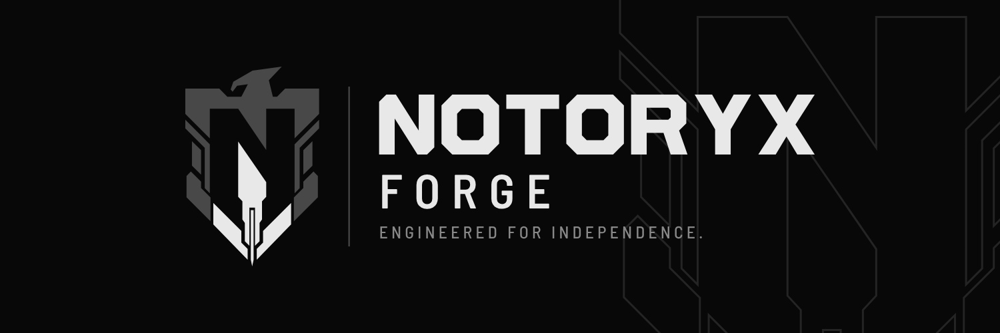
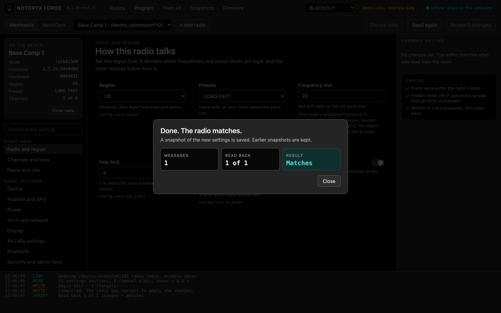
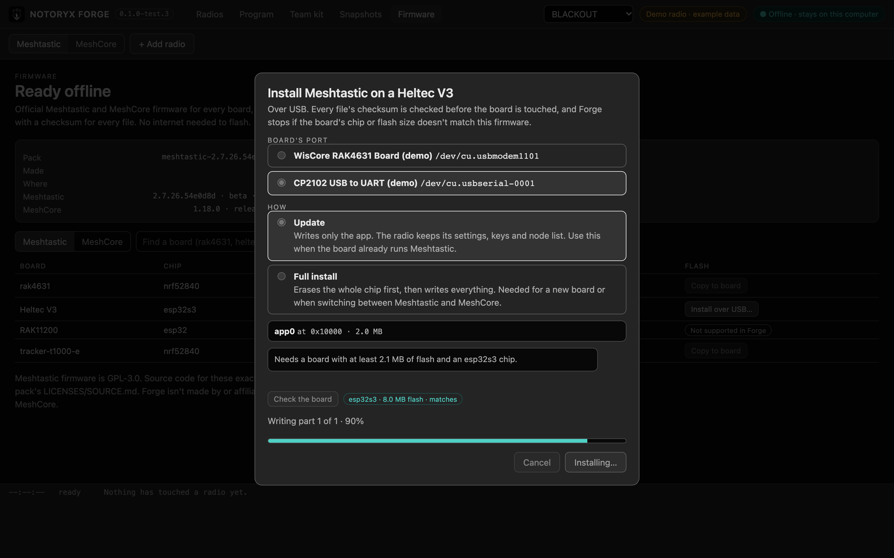
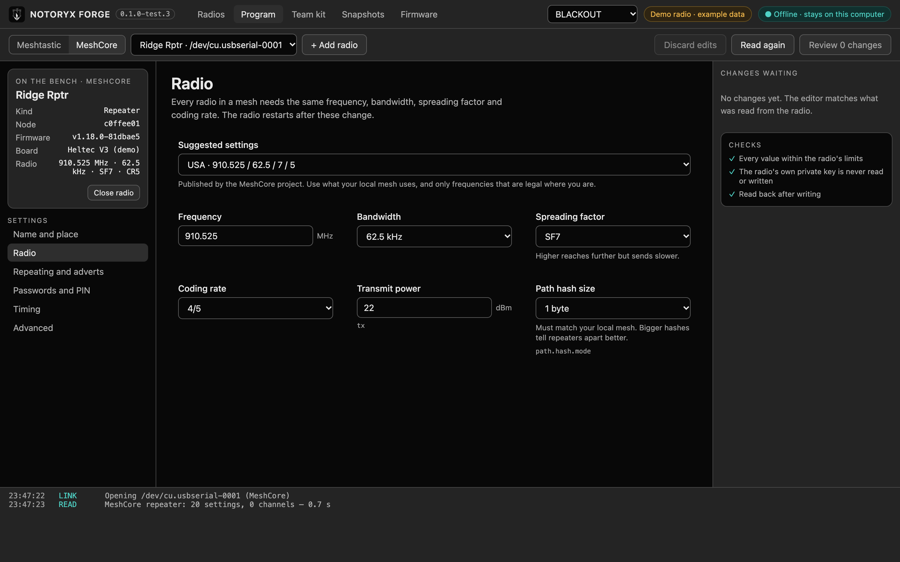
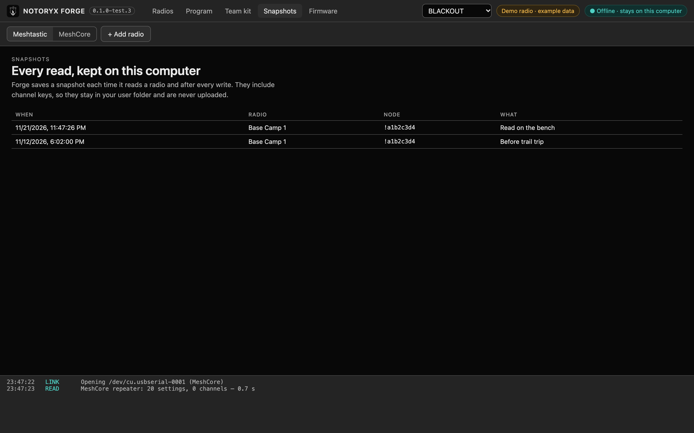

# NOTORYX Forge releases

Downloads for NOTORYX Forge, a desktop app for programming and flashing Meshtastic and MeshCore radios with no internet, no account and no cloud.

- **Every change checked twice:** Forge reads every setting from the radio and saves a snapshot. Changed fields are highlighted with their old values, and nothing is written until you've reviewed a list of exactly what will change. Afterwards Forge reads the radio back and tells you whether it kept the new settings.
- **Nothing gets lost:** hidden values such as the Wi-Fi password and the radio's private key go back untouched, and settings newer than Forge knows about survive the round trip.
- **Meshtastic and MeshCore:** every Meshtastic setting and channel; MeshCore companion, repeater and room-server settings, channels and keys.
- **Team kits:** set up Tech1, Tech2 and so on with shared channels, new keys and the same radio settings in one go, each radio written and checked in turn. Each radio keeps its own device keys.
- **Firmware ready offline:** installers carry the official Meshtastic Beta and MeshCore release firmware for every supported board, with a checksum for every file. The same firmware pack is also published on its own.
- **ESP32 flashing built in:** Update (keeps settings) or Full install over USB, with checksum, chip and flash-size checks before anything is written.
- **Looks for any light:** BLACKOUT (default), Forge, Daylight, Red night and Night-vision safe, with a dimmer for the night looks.

## Screenshots

From the built-in demo radio with example data.

| | |
|---|---|
|  Find radios on USB, Wi-Fi or Bluetooth |  Review exactly what will change |
|  Read back after every write |  Team kit for several radios |
|  ESP32 flashing with chip and flash checks |  MeshCore repeater settings |
|  Snapshots kept on this computer | |

The BLACKOUT look and icon shown here arrive in the next build; 0.1.0 test.3 still has the earlier look and icon.

## Latest

**[0.1.0 test.3](https://github.com/TheLogsAreScreaming/NOTORYX-Forge-Releases/releases/tag/v0.1.0-test.3)** (2026-11-21, test build): MeshCore programming (companion, repeater and room-server settings, channels and keys), MeshCore team kits, and experimental Bluetooth.

Earlier: [0.1.0 test.2](https://github.com/TheLogsAreScreaming/NOTORYX-Forge-Releases/releases/tag/v0.1.0-test.2) (ESP32 flashing, team kits), [0.1.0 test.1](https://github.com/TheLogsAreScreaming/NOTORYX-Forge-Releases/releases/tag/v0.1.0-test.1).

## Which file

| File | For |
|---|---|
| `NOTORYX-Forge_<version>_universal.dmg` | Mac (Intel and Apple Silicon). Unsigned: right-click the app and choose Open the first time |
| `NOTORYX-Forge_<version>_universal.app.zip` | The same Mac app without the disk image |
| `NOTORYX-Forge_<version>_x64-setup.exe` | Windows 10 and 11. SmartScreen may warn because it isn't signed: choose More info, then Run anyway |
| `NOTORYX-Forge_<version>_amd64.deb` / `.AppImage` | Linux on a PC |
| `NOTORYX-Forge_<version>_arm64.deb` | Raspberry Pi 4 or 5 with 64-bit Raspberry Pi OS (Bookworm) |
| `NOTORYX-Forge-firmware-pack.zip` | The firmware pack alone, to import into Forge from a USB stick (Firmware → Import pack) |
| `SHA256SUMS` | Checksums for every file |

Installers are large (about 600 MB to 1 GB) because the firmware for every board is inside.

On Linux and the Pi, add yourself to the `dialout` group once so Forge can open USB radios: `sudo usermod -aG dialout $USER`, then log out and back in.

## Firmware

Firmware files are unchanged copies of the official releases. Meshtastic firmware is GPL-3.0 and MeshCore firmware is MIT; each pack's `LICENSES/SOURCE.md` links the exact source code for those versions. NOTORYX Forge isn't made by or affiliated with Meshtastic or MeshCore. Meshtastic® is a registered trademark of Meshtastic LLC.

## Status

Early test builds. What has been checked on real hardware over USB:

- **Meshtastic (firmware 2.7.26):** reading every setting, writing a change in one transaction, the radio restarting, and the read-back matching with nothing else changed. A team kit write (7 of 7 changes read back) and a full restore afterwards.
- **Heltec V3 (ESP32-S3):** Full install and Update of Meshtastic 2.7.26 from the app, and firmware for a bigger board refused with nothing written.
- **Heltec V3 with MeshCore companion 1.18.0:** reading every setting and channel, writing and reading back (also after the restart), a MeshCore team kit, and restoring the original settings exactly.

Not yet checked: Bluetooth pairing (experimental), MeshCore repeater and room-server firmware on a radio, Wi-Fi/TCP radios, UF2 flashing from the app, other ESP32 chips, and every platform's installer on real machines.

## Problems or ideas

Open an issue on this repo.

---
🛠️ AI-assisted: built with Anthropic's Claude, directed and reviewed by [BaconDisk22](https://github.com/BaconDisk22). Checked by automated tests and CI; review before relying on it.
