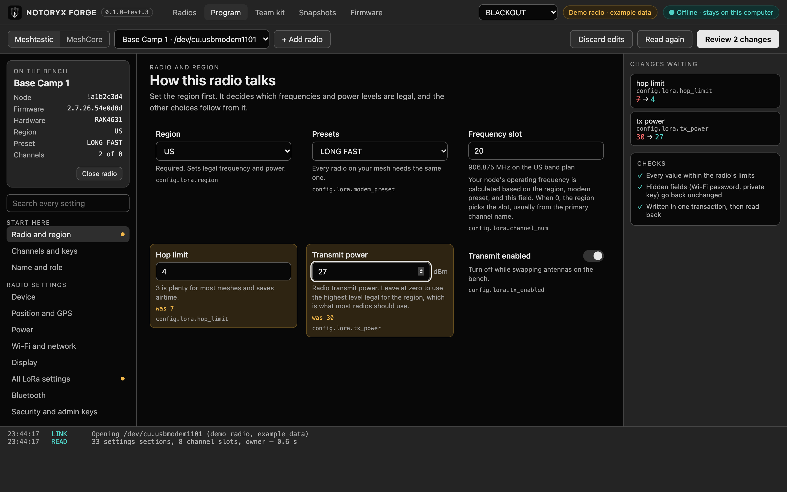
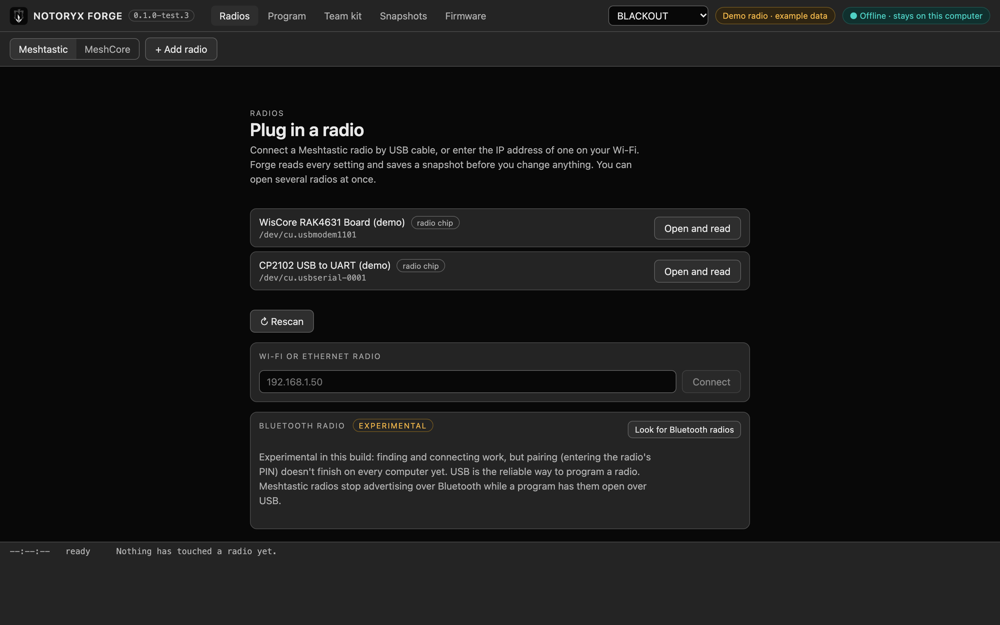
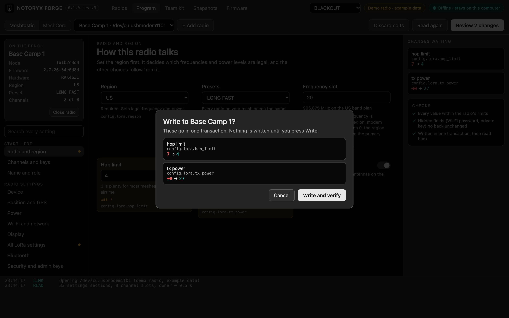
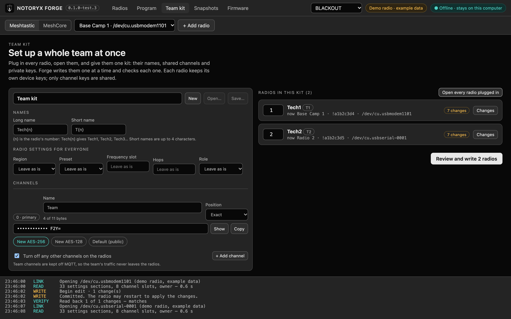

# NOTORYX Forge releases

Downloads for NOTORYX Forge, a desktop app for programming and flashing Meshtastic and MeshCore radios with no internet, no account and no cloud.

- **Every change checked twice:** Forge reads every setting from the radio and saves a snapshot. Changed fields are highlighted with their old values, and nothing is written until you've reviewed a list of exactly what will change. Afterwards Forge reads the radio back and tells you whether it kept the new settings.
- **Nothing gets lost:** hidden values such as the Wi-Fi password and the radio's private key go back untouched, and settings newer than Forge knows about survive the round trip.
- **Meshtastic and MeshCore:** every Meshtastic setting and channel; MeshCore companion, repeater and room-server settings, channels and keys.
- **Team kits:** set up Tech1, Tech2 and so on with shared channels, new keys and the same radio settings in one go, each radio written and checked in turn. Each radio keeps its own device keys.
- **Firmware ready offline:** installers carry the official Meshtastic Beta and MeshCore release firmware for every supported board, with a checksum for every file. The same firmware pack is also published on its own.
- **ESP32 flashing built in:** Update (keeps settings) or Full install over USB, with checksum, chip and flash-size checks before anything is written.
- **Firmware updates in a click:** when Meshtastic or MeshCore publish new firmware, a new Forge pack is built and Forge offers it. Each radio then updates with one click and keeps its settings, or use Update all for every plugged-in radio.
- **Restore and copy:** put a radio back to any earlier snapshot, or copy one radio's settings to another, which keeps its own name and keys.
- **Looks for any light:** BLACKOUT (default), Forge, Daylight, Red night and Night-vision safe, with a dimmer for the night looks.

## Screenshots

From the built-in demo radio with example data.

| | |
|---|---|
|  Find radios on USB, Wi-Fi or Bluetooth |  Review exactly what will change |
|  Read back after every write |  Team kit for several radios |
|  ESP32 flashing with chip and flash checks |  MeshCore repeater settings |
|  Snapshots kept on this computer | |

## Latest

**[0.1.0 test.7](https://github.com/TheLogsAreScreaming/NOTORYX-Forge-Releases/releases/tag/v0.1.0-test.7)** (2026-11-25, test build): one-click firmware updates for every supported board (new firmware offered automatically), restore from snapshots, and copying a radio's settings to another.

Earlier: [0.1.0 test.6](https://github.com/TheLogsAreScreaming/NOTORYX-Forge-Releases/releases/tag/v0.1.0-test.6) (MeshCore Bluetooth), [0.1.0 test.5](https://github.com/TheLogsAreScreaming/NOTORYX-Forge-Releases/releases/tag/v0.1.0-test.5) (Meshtastic Bluetooth), [0.1.0 test.4](https://github.com/TheLogsAreScreaming/NOTORYX-Forge-Releases/releases/tag/v0.1.0-test.4) (BLACKOUT look and icon), [0.1.0 test.3](https://github.com/TheLogsAreScreaming/NOTORYX-Forge-Releases/releases/tag/v0.1.0-test.3) (MeshCore programming, experimental Bluetooth), [0.1.0 test.2](https://github.com/TheLogsAreScreaming/NOTORYX-Forge-Releases/releases/tag/v0.1.0-test.2) (ESP32 flashing, team kits), [0.1.0 test.1](https://github.com/TheLogsAreScreaming/NOTORYX-Forge-Releases/releases/tag/v0.1.0-test.1).

## Which file

| File | For |
|---|---|
| `NOTORYX-Forge_<version>_universal.dmg` | Mac (Intel and Apple Silicon). Unsigned: right-click the app and choose Open the first time |
| `NOTORYX-Forge_<version>_universal.app.zip` | The same Mac app without the disk image |
| `NOTORYX-Forge_<version>_x64-setup.exe` | Windows 10 and 11. SmartScreen may warn because it isn't signed: choose More info, then Run anyway |
| `NOTORYX-Forge_<version>_amd64.deb` / `.AppImage` | Linux on a PC |
| `NOTORYX-Forge_<version>_arm64.deb` | Raspberry Pi 4 or 5 with 64-bit Raspberry Pi OS (Bookworm) |
| `NOTORYX-Forge-firmware-pack.zip` | The firmware pack alone, to import into Forge from a USB stick (Firmware → Import pack) |
| `SHA256SUMS` | Checksums for every file |

Installers are large (about 600 MB to 1 GB) because the firmware for every board is inside.

On Linux and the Pi, add yourself to the `dialout` group once so Forge can open USB radios: `sudo usermod -aG dialout $USER`, then log out and back in.

## Firmware

Firmware packs are published here as separate releases named "Firmware pack: …", built automatically each time Meshtastic (Beta) or MeshCore publish new firmware. `firmware/latest.json` describes the newest one; Forge reads it to offer updates.

Firmware files are unchanged copies of the official releases. Meshtastic firmware is GPL-3.0 and MeshCore firmware is MIT; each pack's `LICENSES/SOURCE.md` links the exact source code for those versions. NOTORYX Forge isn't made by or affiliated with Meshtastic or MeshCore. Meshtastic® is a registered trademark of Meshtastic LLC.

## Status

Early test builds. What has been checked on real hardware:

- **Meshtastic (firmware 2.7.26):** reading every setting, writing a change in one transaction, the radio restarting, and the read-back matching with nothing else changed. A team kit write (7 of 7 changes read back) and a full restore afterwards.
- **Heltec V3 (ESP32-S3):** Full install and Update of Meshtastic 2.7.26 from the app, and firmware for a bigger board refused with nothing written.
- **Heltec V3 with MeshCore companion 1.18.0:** reading every setting and channel, writing and reading back (also after the restart), a MeshCore team kit, and restoring the original settings exactly.
- **Meshtastic over Wi-Fi (TCP):** reading, writing a change and restoring it, read back after each restart.
- **Meshtastic over Bluetooth on a Mac:** pairing from scratch with the PIN, reading, writing a change and restoring it, read back after each restart.
- **MeshCore over Bluetooth on a Mac (Heltec V3, companion 1.18.0):** pairing from scratch with the PIN, reading every setting and channel, writing a change and changing it back, each read back.
- **Installers:** each one installed and opened on clean GitHub-hosted machines: Windows Server 2022 and 2025, macOS 15, Ubuntu 22.04 and 24.04, Debian 12, the AppImage, and Debian 12 and 13 on arm64 (the bases of Raspberry Pi OS).

Not yet checked: Bluetooth on Windows and Linux, MeshCore repeater and room-server firmware on a radio, UF2 flashing from the app, other ESP32 chips, and the installers on real desktop PCs and a real Raspberry Pi.

## Problems or ideas

Open an issue on this repo.

---
🛠️ AI-assisted: built with Anthropic's Claude, directed and reviewed by [BaconDisk22](https://github.com/BaconDisk22). Checked by automated tests and CI; review before relying on it.
